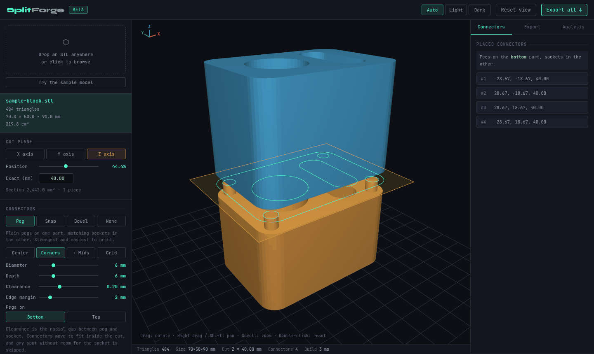
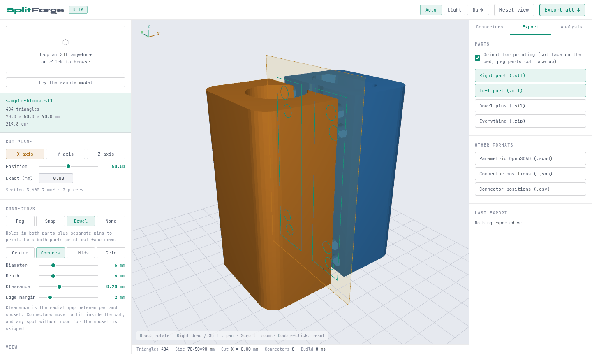
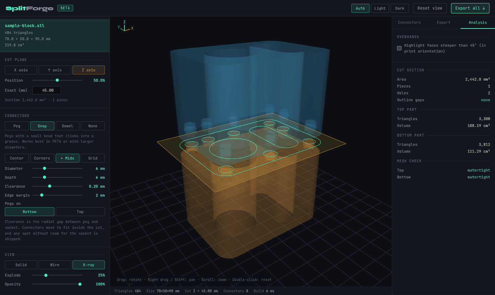
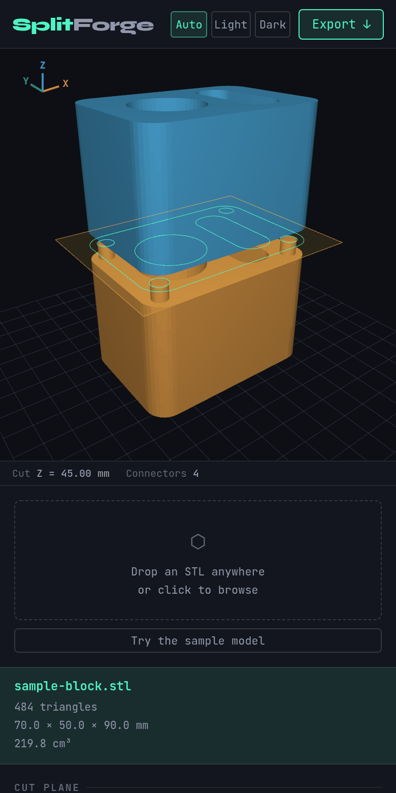

# SplitForge

**Split 3D models into printable parts that fit back together.**

Is the model too big for your printer, or would it print better in two halves? Drop the STL into SplitForge, choose where to cut, and it gives you two watertight parts with pegs, snap-fits or dowel holes already in place. It runs entirely in your browser: nothing is uploaded and nothing needs installing.



## What it does

- **Cuts cleanly.** Both cut faces are filled and every part comes out as a closed, watertight solid, ready for any slicer. Sections with holes, and cuts that leave several separate pieces, are handled too.
- **Places connectors where they fit.** Connectors go inside the actual cut outline, clear of holes and edges, and each separate piece gets its own. If there isn't enough material behind a spot for the socket, that connector is skipped rather than punching through the far side.
- **Exports parts ready to print.** Each part is rotated onto the bed (cut face down, or pegs pointing up) and saved as STL. You can also download everything as one zip.
- **Shows the details.** Exploded, wireframe and X-ray views, the cut outline drawn on the plane, an overhang check in print orientation, and a watertightness check for both parts.



## Connector types

| Type | What you get | Good for |
| --- | --- | --- |
| **Peg** | Chamfered pegs on one part, matching sockets in the other | Most prints. Strong and easy to line up |
| **Snap** | Pegs with a small bead that clicks into a groove | Parts you want to press together without glue (PETG, larger diameters) |
| **Dowel** | Holes in both parts plus separate pins to print | Printing both parts cut face down for the cleanest joint |
| **None** | Just the cut | Gluing, or adding your own joinery |

Connectors can be laid out at the centre, the corners, the corners plus midpoints, or in a grid. You can set the diameter, depth, clearance and edge margin, and choose which part carries the pegs.



## Getting started

1. Serve the folder with any static web server. For example, run `python3 -m http.server` and open <http://localhost:8000>.
2. Drop an STL onto the page, or click **Try the sample model**.
3. Pick the cut axis and drag **Position**, or type an exact height in mm.
4. Choose a connector type and pattern, and check the result in the viewport.
5. Open **Export** and download the parts, or **Everything (.zip)**.

**Viewport controls:** drag to rotate, right-drag or Shift-drag to pan, scroll to zoom, double-click to reset. On a touchscreen, use one finger to rotate and two to pinch and pan.



### Tips

- **Clearance** is the gap around each peg. 0.15–0.25 mm suits most FDM printers. Print a small test piece before committing to a big part.
- If connectors are skipped, the cut is too thin for the socket. Use a shallower or narrower connector, a smaller edge margin, or move the cut.
- **Dowel** mode lets both parts print cut face down, which gives the flattest mating surfaces.
- The model should be watertight. SplitForge warns you if it isn't, because a mesh with holes can leave gaps in the cut face.
- Light, dark and automatic themes are in the top bar, and the layout also works on phones and tablets.

### Exports

| Export | Contents |
| --- | --- |
| Part STLs | Each half as binary STL, optionally rotated onto the print bed |
| Dowel pins | One STL with every pin laid out ready to print |
| Everything (.zip) | Both parts, pins, connector positions and the OpenSCAD file |
| OpenSCAD | A parametric version that rebuilds the split from the original STL, so you can tweak it further |
| JSON / CSV | Connector positions in model coordinates |

<br clear="right">

## Development

There's no build step: `index.html` loads plain scripts from `src/`.

| File | Purpose |
| --- | --- |
| `src/stl.js` | Binary and ASCII STL parsing, binary STL writing |
| `src/split.js` | Mesh welding, cutting, cap triangulation, connector placement and geometry, print orientation, overhangs. It has no DOM access, so it runs under Node |
| `src/sample.js` | The built-in sample model |
| `src/renderer.js` | WebGL2 viewport |
| `src/exporters.js` | STL, zip, OpenSCAD, JSON and CSV export |
| `src/app.js` | UI wiring |
| `src/vendor/earcut.js` | [earcut](https://github.com/mapbox/earcut) 2.2.4 polygon triangulation (ISC licence) |

The geometry tests split a range of shapes on every axis with every connector type. They check that each part is a closed, consistently oriented solid, that connectors stay inside the material, and that volumes add up. Run them with Node 18 or later:

```sh
npm test
```
