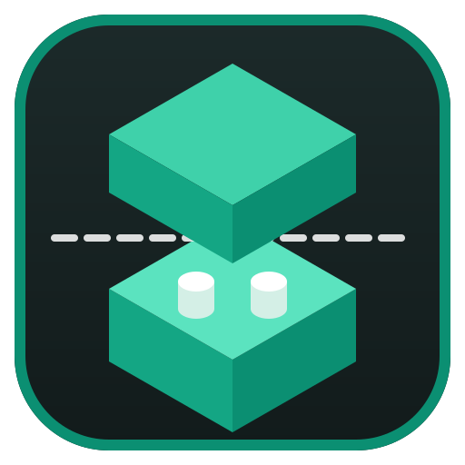
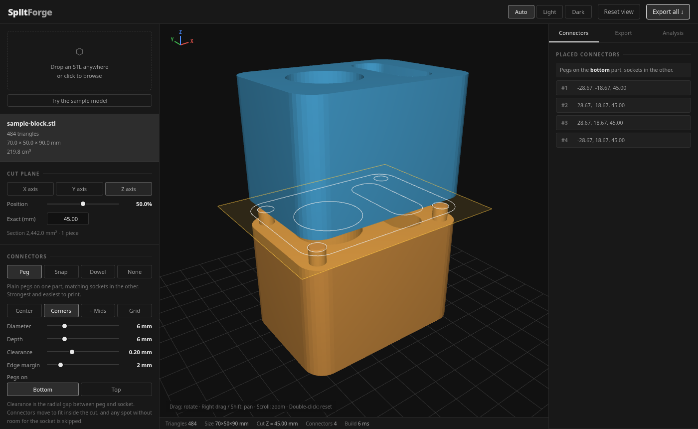
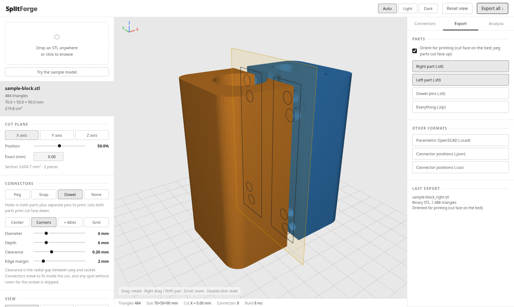
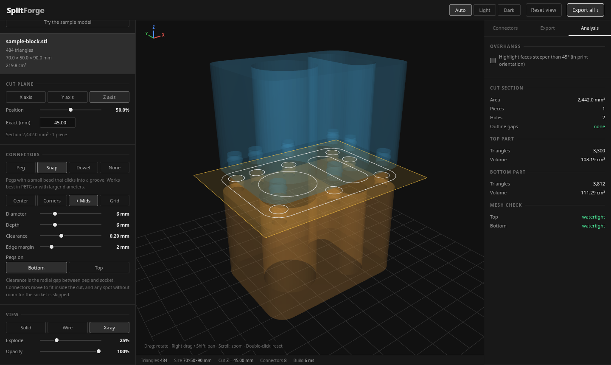

#  SplitForge

**Split 3D models into printable parts that fit back together.**

Model too big for your printer? Drop the STL into SplitForge, choose where to cut, and get two watertight parts with pegs, snap-fits or dowel holes already in place. It runs entirely in your browser: nothing is uploaded.

## Features

- **Clean cuts**: both parts come out as closed, watertight solids, ready for any slicer
- **Connectors that fit**: pegs, snap-fits or dowels, placed inside the cut and clear of edges
- **Ready to print**: each part is rotated onto the bed and saved as STL, or download everything as a zip
- **Check before you print**: exploded, wireframe and X-ray views, plus overhang and watertightness checks
- **Works on phones and tablets**, in light or dark

  
  

## Get it

Download the source zip from the [latest release](../../releases/latest), unzip it and serve the folder with any static web server, for example `python3 -m http.server`, then open <http://localhost:8000>.

New to it? The [user guide](docs/guide.md) covers connectors, exports and print tips.

## Licence

Free and open source under the [GNU AGPL v3 or later](LICENSE). Want to work on it? See [BUILDING.md](BUILDING.md).
