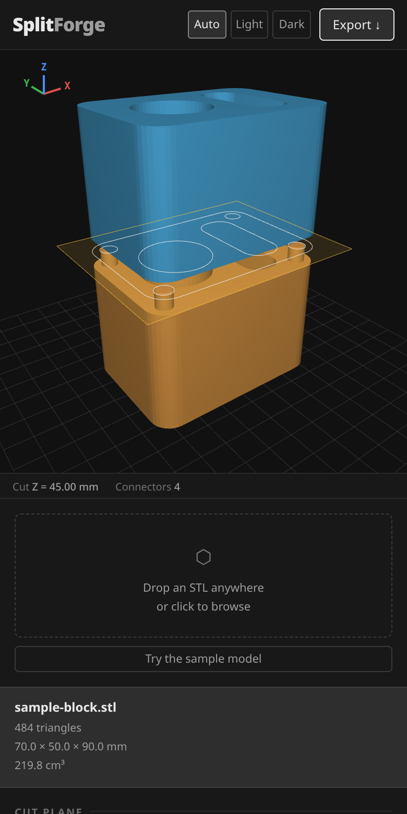

# Using SplitForge

## Getting started

1. Drop an STL onto the page, or click **Try the sample model**.
2. Pick the cut axis and drag **Position**, or type an exact height in mm.
3. Choose a connector type and pattern, and check the result in the viewport.
4. Open **Export** and download the parts, or **Everything (.zip)**.

**Viewport controls:** drag to rotate, right-drag or Shift-drag to pan, scroll to zoom, double-click to reset. On a touchscreen, use one finger to rotate and two to pinch and pan.

## Connector types

| Type | What you get | Good for |
| --- | --- | --- |
| **Peg** | Chamfered pegs on one part, matching sockets in the other | Most prints. Strong and easy to line up |
| **Snap** | Pegs with a small bead that clicks into a groove | Parts you want to press together without glue (PETG, larger diameters) |
| **Dowel** | Holes in both parts plus separate pins to print | Printing both parts cut face down for the cleanest joint |
| **None** | Just the cut | Gluing, or adding your own joinery |

Connectors can be laid out at the centre, the corners, the corners plus midpoints, or in a grid. You can set the diameter, depth, clearance and edge margin, and choose which part carries the pegs.

Connectors go inside the actual cut outline, clear of holes and edges, and each separate piece of the cut gets its own. If there isn't enough material behind a spot for the socket, that connector is skipped rather than punching through the far side.

## Tips

- **Clearance** is the gap around each peg. 0.15–0.25 mm suits most FDM printers. Print a small test piece before committing to a big part.
- If connectors are skipped, the cut is too thin for the socket. Use a shallower or narrower connector, a smaller edge margin, or move the cut.
- **Dowel** mode lets both parts print cut face down, which gives the flattest mating surfaces.
- The model should be watertight. SplitForge warns you if it isn't, because a mesh with holes can leave gaps in the cut face.
- Light, dark and automatic themes are in the top bar.

## Exports

| Export | Contents |
| --- | --- |
| Part STLs | Each half as binary STL, optionally rotated onto the print bed |
| Dowel pins | One STL with every pin laid out ready to print |
| Everything (.zip) | Both parts, pins, connector positions and the OpenSCAD file |
| OpenSCAD | A parametric version that rebuilds the split from the original STL, so you can tweak it further |
| JSON / CSV | Connector positions in model coordinates |
